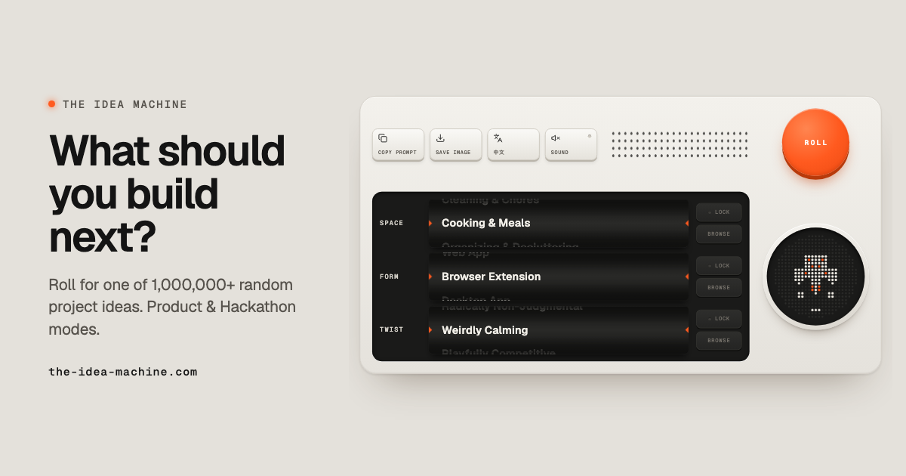

# The Idea Machine

An idea generator: roll the machine and it mashes up three reels into a
random project idea — meant to spark inspiration, not hand you a validated
idea. It has two modes:

- **Product** (`/`): a space in human life × a product form × a twist
- **Hackathon** (`/hackathon/`): a topic × a piece of tech × a twist

Each mode has over 1,000,000 combinations, in English and Chinese.

**Use it at [the-idea-machine.com](https://www.the-idea-machine.com/).** You
don't need to run this code to use the app — the live site is the intended
way to play with it.



## What you can do

- **Roll** for a new idea, or **lock** a reel to keep it while the others change.
- **Browse** a reel to pick an item yourself, or nudge it with the scroll
  wheel, a drag, or the arrow keys.
- **Copy prompt** — copies a prompt you can paste into an AI assistant to
  brainstorm the idea. Locked words are passed on as required, the rest as
  loose inspiration.
- **Save image** — a shareable PNG card of your idea, with a QR code back
  to the mode it came from.
- **Share a link** — every idea has a code in the URL (e.g. `/#047-02-049`),
  so the link opens the same idea.
- **Recent** — your ideas from this browser session, kept per mode.

Around the machine:

- [**About**](https://www.the-idea-machine.com/about/) — how it works, the two
  modes, and FAQ.
- [**Examples**](https://www.the-idea-machine.com/examples/) — real rolls
  from both modes, each with a one-line pitch.
- [**Maps**](https://www.the-idea-machine.com/maps/) — every item on each
  mode's three reels, by category
  ([Hackathon](https://www.the-idea-machine.com/maps/hackathon/)).
- [**Legacy**](https://www.the-idea-machine.com/legacy/) — the original
  slot-machine design (v1).

## Contributing

This repo is open for contributions:

- **Found a bug, or have an idea for a feature?** Open an issue.
- **Want to expand the idea pool?** Each mode draws from 3 "maps" —
  plain JSON files under [`src/data/maps/`](src/data/maps/), all in the same
  shape (`meta` + `categories[] { category, category_zh, subItems, subItems_zh }`):
  - Product: `map-of-human-life.json` (spaces in human life),
    `map-of-product-forms.json` (product forms), `map-of-twists.json` (twists)
  - Hackathon: `map-of-hackathon-topics.json`, `map-of-hackathon-tech.json`,
    `map-of-hackathon-twists.json`

  Adding a new domain, category, or twist to one of these files is one of the
  easiest ways to contribute — no code changes required. Every item needs both
  an English and a Chinese entry, in the same position in `subItems` and
  `subItems_zh`. PRs welcome.

  Note: idea codes in shared links are positions in these lists, so adding
  items anywhere but the end of the last category shifts which idea an older
  link opens. That's fine, just good to know.

### Running locally

Only needed if you want to submit code changes. This is a Vite + React +
Tailwind CSS v4 app. Requires Node 18, 20, or 22+ (Vite 6 doesn't support
odd-numbered Node releases like 19 or 21).

```sh
npm install
npm run dev
```

Then open the printed local URL (e.g. http://localhost:5173).

To produce a production build: `npm run build` (output goes to `dist/`), and
`npm run preview` to serve it locally.

Where things live:

- `src/app/instrument/` — the current machine. `modes.ts` defines the two
  modes (which maps, reel names, prompt text); `machine.ts` is the state
  (picking, locks, idea codes, history); `controller.ts` draws it and wires
  the controls; `save.ts` is the Save image card; `InstrumentPage.tsx` is the
  React page around it; `SiteChrome.tsx` is the top bar and footer shared
  with the other pages.
- `src/app/pages/` — the About (`/about/`), Examples (`/examples/`) and Maps
  (`/maps/`, `/maps/hackathon/`) pages.
- `src/data/site-content.json` — every word around the machine: the model
  plate (each machine page's `<h1>`) and description, and the About,
  Examples and Maps copy, in English and Chinese. `src/app/siteContent.ts`
  reads it for the app.
- `src/app/legacy/` — the original slot machine at `/legacy/`, kept as-is.
- `src/app/analytics.ts` — the Google Analytics events the app sends.
- `src/assets/share-qr*.svg` — the static QR codes on saved images, one per
  mode.

### Deployment

Pushing to `main` builds and deploys the site to GitHub Pages
(`.github/workflows/deploy.yml`). GitHub Pages only serves static files, so
`npm run build` also runs `scripts/generate-route-shells.mjs`, which:

- writes a copy of `index.html` for each route with that page's title,
  description, canonical URL and structured data, plus the page's text
  (from `site-content.json` and the maps) inside `<div id="root">`, so
  crawlers and AI agents that don't run JavaScript can read it. React
  replaces that markup when the app loads;
- writes redirect pages from the v1 map URLs (`/maps/space/`,
  `/maps/format/`, `/maps/twist/`) to the matching section of `/maps/`;
- writes `sitemap.xml`, `llms.txt` and `llms-full.txt`.

URLs end in `/` (that's what GitHub Pages serves). `public/404.html` sends
any other URL back to the app.

## License

[MIT](LICENSE)
